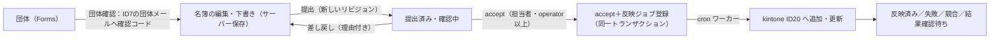

# 部員名簿フォームと kintone 連携（第1段階）

団体が Forms の専用フォームで部員名簿を入力・提出し、総合管理事務局が kintone管理サイトで差分を確認して
差し戻し・accept する。**accept した提出リビジョンの内容だけ**が、cron のワーカーで kintone ID20「部員名簿」へ
自動で追加・更新される。

- 提出・下書き保存・差し戻し・再提出・画面表示では kintone を一切更新しない。
- 審査状態（下書き／提出済み・確認中／差し戻し／accepted）と反映状態（未反映／反映待ち／反映中／反映済み／失敗／競合／結果確認待ち）を別々に保存する。
- 顧問承諾書・クラブハウス部屋鍵保有者登録書は従来どおり書類で提出（今回は対象外）。
- 役員の人物情報（ID22）・役員台帳（ID21）への連動は第2段階（下記「第2段階の拡張点」）。画面にも「役員台帳へ反映済み」とは表示しない。

関連文書: [setup.md](setup.md)（導入手順・設定例・kintone の設定）／[runbook.md](runbook.md)（運用・障害対応）／[verification.md](verification.md)（検証結果）

## 全体の流れ

## 主な仕組み

| 項目 | 内容 |
| --- | --- |
| 業務単位 | フォーム × 対象年度（フォーム設定で明示）× 団体識別記号。メール・団体名が変わっても同じ団体の履歴が続く |
| 団体確認 | 団体識別記号を選ぶと、ID7 に登録された団体メールへ6桁の確認コードを送る。確認できたセッションだけがその団体の名簿を扱える（団体はサーバー側で決め、画面から送られた識別記号は使わない） |
| 下書き | サーバーに保存（ブラウザの永続保存に個人情報を残さない）。版番号で別画面からの上書きを防ぐ |
| 提出 | 新しいリビジョン（変更しない原本）として保存。反映待ちの accept があれば失効させ、承認待ちに戻す |
| accept | kintone の現在値を取得して担当者が見た比較元と一致する場合だけ、accept（スナップショット・比較元のレコードID／リビジョン）と反映ジョブを同じトランザクションで保存。連打・再送は同じ accept に集約 |
| 反映 | ワーカーが期限付きロックで1件ずつ取得し、実行時にも accept の有効性（取消・新しい提出・対象年度・スナップショットの改ざん）を確認。ID20 を団体識別番号で検索し、0件→新規作成、1件→期待リビジョンを指定して更新、複数件→競合で停止 |
| 行の扱い | 既存行は行IDを維持し、職名（role_name）など未編集の項目も全項目を送り直す。提出に含まれない既存行は削除しない。卒部・退部は状態の変更 |
| 成否不明 | 書込みの応答が届かない場合は「結果確認待ち」にし、時間をおいて kintone を検索・照合してから判断する（同じ登録を単純に再送しない） |
| フィールド検査 | kintone は存在しないフィールドを黙って無視するため、毎回書込み前に ID20 のフィールド・選択肢を検査し、不足なら「設定エラー」で止める。書込み後は読み戻して照合する |
| 既存同期との分離 | 部員名簿アプリは汎用の push/pull/再同期から更新・取得できない（kintone_sync_service のガード） |

## 変更したファイル

新規
- `apps/roster_core/`（bootstrap / schema / domain / directory / verification / case_service / kintone_adapter / worker）
- `apps/roster_core/migrations/001_roster_tables.sql`（`php tools/roster_migration_sql.php` で生成）
- `apps/jobs/roster_kintone_apply.php`（cron のワーカー）
- `public_html/forms/api/roster.php`（団体側 API）、`public_html/forms/api/admin_roster_cases.php`（Forms 管理画面の一覧・表示のみ）
- `public_html/forms/assets/js/roster.js`（名簿の入力画面）
- `public_html/kintone/roster.php`・`roster_detail.php`・`roster_settings.php`・`_roster.php`・`api/roster_action.php`（担当者の画面・操作）
- `tools/roster_migration_sql.php`
- `tests/roster_workflow_test.php`・`tests/roster_http_test.php`・`tests/support/`（検証用。本番には配置不要）

変更
- `apps/forms_module.php`: フォーム種別（通常／部員名簿）・対象年度・電話番号の必須範囲の設定。名簿の提出履歴があるフォームは削除・種別変更を拒否
- `public_html/forms/api/submit.php`: 名簿フォームへの一般提出を拒否
- `public_html/forms/index.php`・`assets/js/public.js`・`assets/css/app.css`: 名簿フォームを専用画面で表示
- `public_html/forms/admin.php`・`assets/js/admin.js`: 名簿フォームの設定欄、提出一覧（kintone管理サイトへのリンク）
- `apps/kintone_core/kintone_sync_service.php`: 部員名簿アプリを汎用同期から除外するガード
- `public_html/kintone/_layout.php`・`index.php`・`logs.php`・`settings.php`・`assets/css/app.css`: メニューとダッシュボードを部員名簿中心に変更
- 旧機能（CSV名簿取込・差分承認・レビュー・団体マスタ・団体マスタの kintone 同期）は原則廃止。画面・メニュー・ダッシュボード・ログの同期ジョブ表示から外し、ページは名簿の画面へ、API は 404 を返す（`kintone_require_legacy_feature()`）。ソースは流用のため残しており、`kintone.legacy_features_enabled = true` で再び使える
- `apps/config_up.php`: `roster` 設定の例
- `apps/kintone_core/bootstrap.php`・`apps/lend_core/bootstrap.php`・`apps/forms_config.php`: 環境変数 `FITSC_CONFIG_FILE` による設定ファイルの差し替え（ローカル検証用。未設定時の動作は従来どおり）

`organizations`（団体マスタ）のテーブル・データと、それを参照するメール・予約の機能はそのまま動く（廃止したのは kintone管理サイト上の旧機能の画面・API だけ）。旧データ・旧ジョブの削除も行わない。

## 第2段階（役員連動）の拡張点

第1段階は ID20 への反映まで。役員連動に必要な追加情報と拡張箇所は次のとおり（未実装）。

| 対象 | 必要になること | 拡張箇所 |
| --- | --- | --- |
| ID22 登録者 | 役員の人物登録。必須項目（所属 `depend`、姓 `family_name`、名 `personal_name`、メール `mail`、種別 `type`、所属状態 `org_depend_state` 等）を名簿の入力に追加する必要がある。学籍番号で既存の人物と照合 | `roster_validate_rows()` に役員用の必須項目、`roster_snapshot_rows()` に項目追加、`kintone_adapter.php` に ID22 の検索・追加 |
| ID21 役員台帳 | 役職ごとの固定欄（代表1・副代表2・会計長1・副会計長2・総務3。マネージャーは欄なし）へ割り当て。人数超過の扱いを業務で決める必要がある。フィールドコードの綴り `representative_stundet_id` 等はそのまま使う | 反映ジョブに「ID21 更新」の段階を追加（ID20 反映と同様に期待リビジョン・成否不明の照合） |
| 画面 | 役員の追加入力欄、担当者画面に ID22/ID21 の差分 | `roster.js`・`roster_detail.php` |

反映ジョブは accept ごとに1件で、段階（phase）と書込み種別（write_kind）を記録しているため、ID22・ID21 の段階を後ろに追加できる。
